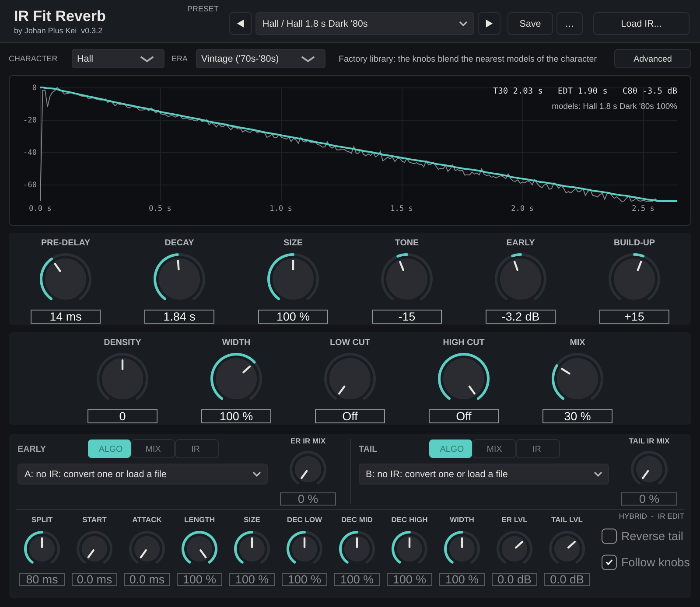

# IR Fit Reverb（JUCE プラグイン）

by Johan Plus Kei — IR（インパルスレスポンス）の響きを**アルゴリズムで再現**し、Pre-Delay・Decay・Size・Tone などの**定番パラメーターで操作**できるリバーブ（VST3 / AU / Standalone）。手持ちの IR を読み込んで、自分用のアルゴリズミックリバーブ・プリセットに変換できます。エンジンは [Reverb Anatomy Lab](https://github.com/kazufumi01/ReverbAnatomyLab) と共通です。



🔗 **学習ラボ・解説ページ / Learning labs & articles：** [Learning labs（GitHub Pages）](https://kazufumi01.github.io/) ・ [目次・解説記事（Seesaa・日本語）](https://jpk.seesaa.net/article/521891797.html)

## ⬇️ ダウンロード / Download

**[最新版をダウンロード / Download latest](https://github.com/kazufumi01/IRFitReverb/releases/latest)** — 無料配布中（β）/ Free (beta)

| | 手動インストール（おすすめ） | インストーラー |
|---|---|---|
| **Mac**（macOS 11+, Apple Silicon / Intel） | [`IRFitReverb-0.3.2-mac.zip`](https://github.com/kazufumi01/IRFitReverb/releases/latest/download/IRFitReverb-0.3.2-mac.zip) | [`IRFitReverb-0.3.2-mac.pkg`](https://github.com/kazufumi01/IRFitReverb/releases/latest/download/IRFitReverb-0.3.2-mac.pkg) |
| **Windows**（10 / 11, 64bit）⚠️未検証 | [`IRFitReverb-0.3.2-win64.zip`](https://github.com/kazufumi01/IRFitReverb/releases/latest/download/IRFitReverb-0.3.2-win64.zip) | [`IRFitReverb-0.3.2-win64.exe`](https://github.com/kazufumi01/IRFitReverb/releases/latest/download/IRFitReverb-0.3.2-win64.exe) |

- インストール方法：**[INSTALL.md](INSTALL.md)**（日本語 / English）
- ⚠️ **Windows 版は実機での動作確認ができていません**（自動ビルドで作成。VST3 と Standalone）。 / The Windows build is untested on real hardware.
- Apple の公証・Windows のコード署名をしていないため、初回のみ警告が出ます。
- 不具合・要望は [Issues](https://github.com/kazufumi01/IRFitReverb/issues) へ。

---

## 主な機能

- **IR から作った 92 のアルゴリズム・モデルを内蔵**：Hall / Room / Chamber / Plate / Ambient × Vintage（'70s–'80s）/ Modern。再生時に IR もコンボリューションも使いません
- **定番のつまみで操作**：Pre-Delay・Decay・Size・Tone・Early・Build-up・Density・Width・Low Cut・High Cut・Mix。つまみの位置に近いモデルを滑らかにブレンドし、残響時間・明るさ・初期反射の量が狙いどおりになるよう補正
- **IR → アルゴリズム変換**：IR ファイルを読み込む（ドロップも可）と、その響きを ER のタップ・16 ラインの FDN・EQ・ステレオ幅まで合わせたモデルに変換し、プリセットとして保存。変換後も同じつまみで操作できます
  - **フォルダー一括変換**（サブフォルダーも）：複数を並行して変換、途中で止めても続きから再開。Fast モードで約 2 倍速
  - L / R の組（`名前_L`／`名前_R`）は 1 つの IR として扱います
- **ハイブリッド**：EARLY と TAIL それぞれを ALGO／IR（そのままのコンボリューション）／MIX で再生。IR は Split・Start・Attack・Length・Size・帯域別の Decay・Reverse で編集でき、「Follow knobs」でつまみにも追従
- **残響の可視化**：エコーグラム（モデルと IR の重ね表示）と T30・EDT・C80
- **プリセット**：内蔵（キャラクター別）とユーザー（フォルダー分け）、◀ ▶ で順送り
- **Reverb Anatomy Lab へ書き出し**：変換したモデルを Reverb Anatomy Lab のプリセット（`.rvpreset`）にして、中身のパラメーターを Lab で確かめられます

---

## ビルド

```bash
./build.sh            # 手元の JUCE（~/Documents/jpkplugins/JUCE）を使う。無ければ CMake が JUCE 9.0.4 を取得
```

- Windows は GitHub Actions（`.github/workflows/build-win.yml`、手動実行）で VST3 / Standalone をビルドし、Inno Setup でインストーラーを作成
- Mac のインストーラー作成：`packaging/mac/build_pkg.sh [version]` ／ `packaging/mac/build_zip.sh [version]`（出力は `dist/`）

## ライセンス

JUCE は **Starter ライセンス** で使用。配布物はフリーウェア使用許諾（`packaging/mac/resources/license.txt`）に従います。
ソースは公開していますが、無断での再配布・販売はできません。著作権は Johan Plus Kei にあります。

---

**Johan Plus Kei** — [Spotify](https://open.spotify.com/artist/30PV2gqUbDDwvuWtKaok0x) ・ [Apple Music](https://music.apple.com/us/artist/johan-plus-kei/519360150) ・ [X](https://x.com/johanpluskei) ・ [Instagram](https://www.instagram.com/johanpluskei) ・ [Learning labs](https://kazufumi01.github.io/)

## Support / 支援

IR Fit Reverb is free. If it helps your mixing or your classes, you can support development with a one-time tip via [PayPal](https://paypal.me/johanpluskei). More ways to help: <https://kazufumi01.github.io/support/>

IR Fit Reverb は無料です。ミックスや授業で役立ったら、[PayPal](https://paypal.me/johanpluskei) からの投げ銭で開発を支えていただけるとうれしいです。
